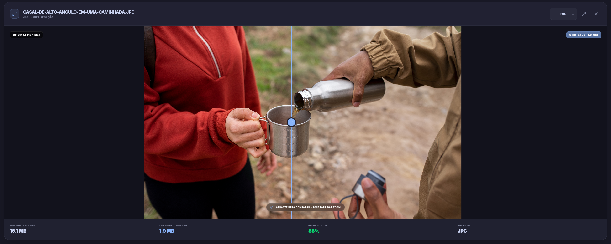

<div align="center">


# Imglyze

**Professional Image Optimization Tool**

[](https://tauri.app/)
[](https://reactjs.org/)
[](https://www.rust-lang.org/)
[](https://www.typescriptlang.org/)
[](#-testing)
[](LICENSE)

*A modern, cross-platform desktop application for intelligent batch image optimization*

[Features](#-features) • [Installation](#-installation) • [Architecture](#-architecture) • [Technologies](#-technologies) • [Development](#-development)

</div>

---

## 📝 About

**Imglyze** is a powerful desktop application designed for professional image optimization. Built with performance and user experience in mind, it combines the speed of Rust with the flexibility of React to deliver a seamless batch processing experience.

Whether you're a web developer optimizing assets, a photographer preparing images for publication, or anyone dealing with large collections of images, Imglyze provides intelligent optimization while maintaining visual quality.

### 🎯 Key Highlights

- **🚀 High Performance** - Rust-powered backend for lightning-fast processing
- **🎨 Modern UI** - Beautiful, responsive interface with dark mode support
- **🔧 Flexible Presets** - Predefined optimization profiles or custom settings
- **📊 Visual Comparison** - Interactive before/after viewer with OpenSeadragon
- **🌍 Multi-Format** - Support for JPG, PNG, WebP, and BMP formats
- **📦 Batch Processing** - Handle multiple files, folders, and ZIP archives
- **🔒 Privacy First** - All processing happens locally on your machine

---

## ✨ Features

### Image Processing

- **Multi-Format Support**: Process JPG, PNG, WebP, and BMP images
- **Smart Optimization**: Intelligent compression algorithms per format
- **Format Conversion**: Convert between supported image formats
- **Quality Control**: Fine-tune quality vs. file size trade-offs
- **File Size Limits**: Set maximum output file sizes
- **Metadata Preservation**: Optionally keep or strip EXIF data

### Batch Operations

- **Multiple Input Sources**:
  - Individual image files
  - Entire folders (with subdirectory support)
  - ZIP archives
- **Flexible Output Options**:
  - ZIP archive with organized structure
  - Folder with preserved hierarchy
  - Replace original files
  - Save with custom suffix
- **Progress Tracking**: Real-time processing status with detailed stats
- **Error Handling**: Comprehensive error reporting per file

### User Experience

- **Drag & Drop**: Intuitive file selection
- **Visual Comparison**: Interactive slider to compare original vs. optimized
- **Preset Management**: Quick access to common optimization profiles
- **Advanced Mode**: Per-format customization options
- **System Theme Sync**: Automatic dark/light mode detection
- **Internationalization**: Built-in i18n support (ready for multiple languages)

## 📊 Compression Results

> **Note**: Imglyze's smart compression algorithm typically achieves **70-90% size reduction** with high visual fidelity.


*Comparison: Original vs Optimized (80% Quality)*

---

## 🏗️ Architecture

Imglyze follows **Clean Architecture** principles with a clear separation of concerns.

For a detailed deep-dive into the system architecture, layers, and design decisions, please refer to the [Architecture Documentation](docs/03-architecture.adoc).

### Design Patterns

#### Backend (Rust)

- **Repository Pattern**: Abstracts file system operations and archive handling
- **Service Layer**: Encapsulates business logic for image optimization
- **Command Pattern**: Tauri commands act as application entry points
- **Strategy Pattern**: Different optimization strategies per image format
- **Builder Pattern**: Used in configuration setup and image processing pipelines

#### Frontend (React)

- **Context API**: Global state management for batch processing
- **Custom Hooks**: Reusable logic for file handling, settings, and theme
- **Component Composition**: Modular UI components with clear responsibilities
- **Feature-Based Structure**: Organized by features (batch-processing, settings)
- **Error Boundaries**: Graceful error handling and recovery

---

## 🛠️ Technologies

### Frontend

| Technology | Purpose |
|-----------|---------|
| **React 19** | UI framework with modern hooks and concurrent features |
| **TypeScript** | Type-safe development with enhanced IDE support |
| **Tailwind CSS 4** | Utility-first styling with custom design system |
| **Framer Motion** | Smooth animations and transitions |
| **OpenSeadragon** | Deep zoom image viewer for comparisons |
| **i18next** | Internationalization framework |
| **Zod** | Runtime type validation and schema definition |
| **Vite** | Fast build tool and dev server |

### Backend

| Library | Purpose |
|---------|---------|
| **Tauri 2** | Cross-platform desktop framework |
| **image** | Image decoding and manipulation |
| **mozjpeg** | Optimal JPEG encoding (better than libjpeg-turbo) |
| **oxipng** | Lossless PNG optimizer with Zopfli compression |
| **webp** | WebP format encoding/decoding |
| **imagequant** | High-quality color quantization for PNGs |
| **img-parts** | EXIF metadata reading and writing |
| **zip** | ZIP archive creation and extraction |
| **tokio** | Async runtime for concurrent processing |
| **serde** | Serialization/deserialization framework |
| **tracing** | Structured logging and diagnostics |

### Development Tools

- **NPM** - Package management
- **Cargo** - Rust build system and package manager
- **ESLint** - JavaScript/TypeScript linting
- **Clippy** - Rust linting
- **GitLab CI** - Continuous integration and deployment

---

## 🎨 Design System

The application features a custom design system with:

- **Custom Color Palette**: Carefully crafted light and dark themes
- **Glassmorphism Effects**: Modern frosted glass UI elements
- **Smooth Animations**: Micro-interactions for enhanced UX
- **Responsive Layout**: Adapts to different window sizes
- **Custom Scrollbars**: Styled scrollbars matching the theme
- **Typography**: Clean, readable font hierarchy

---

## 📦 Installation

### Pre-built Binaries

Download the latest release for your platform:

- **Linux**: `.deb` or `.rpm` packages
- **Windows**: `.msi` installer (coming soon)
- **macOS**: `.dmg` package (coming soon)

### Building from Source

#### Prerequisites

- **Node.js** 18+ and npm
- **Rust** 1.70+ (install via [rustup](https://rustup.rs/))
- **System Dependencies** (Linux):

  ```bash
  sudo apt install libwebkit2gtk-4.1-dev \
    build-essential \
    curl \
    wget \
    file \
    libssl-dev \
    libayatana-appindicator3-dev \
    librsvg2-dev
  ```

#### Build Steps

1. **Clone the repository**

   ```bash
   git clone https://gitlab.com/BrunoF2P/imglyze.git
   cd imglyze
   ```

2. **Install dependencies**

   ```bash
   npm install
   ```

3. **Run in development mode**

   ```bash
   npm run tauri dev
   ```

4. **Build for production**

   ```bash
   npm run tauri build
   ```

The compiled application will be in `src-tauri/target/release/bundle/`.

---

## 🧪 Testing

Imglyze includes comprehensive test suites for both frontend and backend code.

### Test Infrastructure

- **Frontend**: Vitest with React Testing Library
- **Backend**: Cargo test framework with unit and integration tests
- **Coverage**: V8 coverage provider for frontend, built-in cargo coverage

### Running Tests

#### Frontend Tests

```bash
# Run all tests
npm test

# Run tests with UI
npm run test:ui

# Generate coverage report
npm run test:coverage
```

#### Backend Tests

```bash
cd src-tauri

# Run all Rust tests
cargo test

# Run tests with output
cargo test -- --nocapture

# Run specific test
cargo test test_encode_jpeg
```

### Test Structure

**Frontend Tests** (`src/lib/__tests__/`)

- **utils.test.ts** (14 tests) - Utility functions (formatBytes, cn, etc.)
- **validators.test.ts** (10 tests) - Settings and file validation
- **EventBus.test.ts** (8 tests) - Event subscription and emission

**Backend Tests** (`src-tauri/src/`)

- **domain/models.rs** (6 tests) - Domain models serialization and defaults
- **infrastructure/encoders.rs** (11 tests) - Image encoding (PNG, JPEG, WebP, BMP, quantization)

### Current Test Suite

- **Frontend**: 32 tests passing (utils, validators, EventBus)
- **Backend**: 16 tests passing (domain models, image encoders)
- **Total**: 48 comprehensive tests

These tests cover critical functionality including:

- Image encoding/decoding for all formats (PNG, JPEG, WebP, BMP)
- Quality control and quantization algorithms
- Settings validation and sanitization
- Core utility functions and event handling

### Adding New Tests

When adding new features, please include corresponding tests:

1. **Frontend**: Create test files adjacent to source in `__tests__` directories
2. **Backend**: Add `#[cfg(test)]` modules at the end of Rust source files
3. **Integration Tests**: Add to `src-tauri/tests/` for end-to-end scenarios

The test infrastructure is in place with Vitest and Cargo Test configured for easy expansion.

---

## 🚀 Development

### Project Structure

```
imglyze/
├── src/                      # React frontend
│   ├── features/             # Feature modules
│   │   ├── batch-processing/ # Batch processing feature
│   │   └── settings/         # Settings management
│   ├── components/           # Reusable UI components
│   ├── contexts/             # React contexts
│   ├── hooks/                # Custom React hooks
│   ├── lib/                  # Utility functions
│   ├── types/                # TypeScript type definitions
│   └── i18n/                 # Internationalization
├── src-tauri/                # Rust backend
│   ├── src/
│   │   ├── application/      # Application layer (commands, use cases)
│   │   ├── domain/           # Domain layer (models, services)
│   │   ├── infrastructure/   # Infrastructure layer (encoders, repos)
│   │   └── theme/            # System theme detection
│   ├── Cargo.toml            # Rust dependencies
│   └── tauri.conf.json       # Tauri configuration
└── package.json              # Node dependencies
```

### Running Tests

```bash
# Frontend tests
npm test

# Backend tests
cd src-tauri
cargo test
```

### Code Quality

```bash
# Rust linting
cd src-tauri
cargo clippy

# TypeScript linting
npm run lint
```

---

## 🎯 Usage

1. **Launch the application**
2. **Select images** via:
   - Drag and drop
   - File picker (single/multiple files)
   - Folder picker (includes subdirectories)
   - ZIP archive picker
3. **Review discovered files** in the analysis view
4. **Configure settings**:
   - Choose a preset (Balanced, Maximum Quality, Maximum Compression)
   - Or enable Advanced Mode for per-format customization
5. **Select output mode**:
   - ZIP archive
   - Folder (preserves structure)
   - Replace originals
   - Add suffix to filenames
6. **Start processing** and monitor progress
7. **Review results** with visual comparisons
8. **Export** your optimized images

---

## 🤝 Contributing

Contributions are welcome! Please feel free to submit a Pull Request.

### Development Guidelines

- Follow the existing code style
- Write tests for new features
- Update documentation as needed
- Use conventional commits for commit messages

---

## 📄 License

This project is licensed under the MIT License - see the [LICENSE](LICENSE) file for details.

---

## 🙏 Acknowledgments

- **mozjpeg** - Superior JPEG encoding
- **oxipng** - Excellent PNG optimization
- **Tauri** - Amazing cross-platform framework
- **React** - Powerful UI library
- The open-source community for inspiration and tools

---

<div align="center">

**Made with ❤️ and Rust**

[Report Bug](https://gitlab.com/BrunoF2P/imglyze/-/issues) • [Request Feature](https://gitlab.com/BrunoF2P/imglyze/-/issues)

</div>
