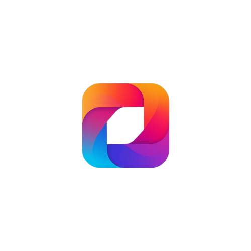
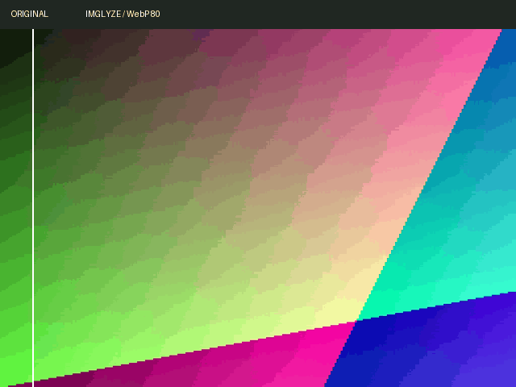

<div align="center">



# Imglyze

### Suas imagens, com menos peso.

Otimize, converta e redimensione imagens em lote.<br>
Compare o resultado antes de exportar, com processamento local no seu computador.

**Rust** · **Tauri 2** · **React** · **TypeScript**

[](https://github.com/BrunoF2P/Imglyze/actions/workflows/ci.yml)

[Recursos](#recursos) · [Formatos](#formatos) · [Desenvolvimento](#desenvolvimento) · [Documentação](#documentação)

</div>

---

## Veja a diferença

<div align="center">



<sub>Demonstração com uma imagem sintética do benchmark e uma saída real do motor.</sub>

</div>

A comparação no aplicativo oferece zoom e um controle deslizante para inspecionar o antes e depois. A prévia usa o mesmo pipeline de processamento do lote.

## Recursos

| | O que você pode fazer |
| :--- | :--- |
| **Compressão em lote** | Processar várias imagens em paralelo, com qualidade e tamanho desejado configuráveis por formato. |
| **Conversão** | Exportar em JPEG, PNG, WebP, BMP ou AVIF. Importar SVG e rasterizá-lo para trabalhar com os demais formatos. |
| **Redimensionamento** | Definir largura, altura ou percentual, mantendo a proporção e evitando ampliar imagens menores. |
| **Comparação visual** | Conferir uma amostra antes de iniciar o lote e comparar os resultados depois do processamento. |
| **Receitas reutilizáveis** | Salvar configurações em presets nomeados e reaplicá-las em outros lotes. |
| **Fila organizada** | Buscar arquivos, filtrar por status e ordenar por nome, tamanho ou economia em bytes e percentual. |
| **Exportação flexível** | Salvar em uma pasta, gerar ZIP com hierarquia, adicionar sufixos ou substituir os originais. |
| **Controle do lote** | Pausar, cancelar e acompanhar resultados, avisos e erros por arquivo. |

A interface tem temas claro e escuro, português e inglês, navegação por teclado nos diálogos e uma fila virtualizada para grandes lotes. Ao terminar em segundo plano, o app pode avisar por notificação do sistema, conforme a permissão habilitada.

## Formatos

| Formato | Importar | Exportar |
| :--- | :---: | :---: |
| JPEG / JPG | ✓ | ✓ |
| PNG | ✓ | ✓ |
| WebP | ✓ | ✓ |
| AVIF | ✓ | ✓ |
| BMP | ✓ | ✓ |
| SVG | ✓ | — |

SVG é rasterizado e exportado como PNG por padrão. As prévias de SVG e AVIF são preparadas como PNG para funcionar também em webviews sem suporte ao decoder AVIF.

## Do arquivo ao resultado

1. **Adicione suas imagens.** Importe arquivos, pastas ou um ZIP.
2. **Ajuste a saída.** Escolha o formato, a compressão, as dimensões e o destino — ou use uma receita salva.
3. **Confira a prévia.** Compare uma amostra para avaliar suas configurações.
4. **Processe e exporte.** Acompanhe o lote e abra a pasta de destino pelo aplicativo.

<details>
<summary><strong>Qualidade, segurança e limites de processamento</strong></summary>

- **Qualidade máxima:** o valor 100 usa caminhos sem perdas em PNG e WebP. JPEG e AVIF continuam sendo formatos com perdas nessa configuração.
- **Tamanho desejado:** uma imagem pode exceder o limite solicitado. Nesse caso, o aplicativo registra um aviso.
- **Métrica visual:** o SSIM opcional é calculado sobre luminância, com imagem limitada a 512 px. É um indicador aproximado, não uma garantia de qualidade perceptual.
- **Metadados:** o caminho atual preserva metadata em JPEG, PNG e WebP quando solicitado. Outros formatos registram aviso.
- **Concorrência:** o pool Tokio usa até oito CPUs físicas e um orçamento estimado de 768 MiB compartilhado com as miniaturas. Esse orçamento controla a concorrência; não é um limite rígido de memória do processo. Miniaturas têm no máximo duas tarefas simultâneas.
- **Redimensionamento:** o motor usa SIMD, com filtros Lanczos3 ou Catmull-Rom.
- **Arquivos de saída:** gravação atômica e proteção contra colisões. Ao substituir um original, uma cópia temporária permite compará-lo durante a sessão; ela não constitui um backup permanente.
- **Pausa e cancelamento:** a pausa impede novos trabalhos; encoders em execução terminam. O cancelamento impede novos trabalhos, bloqueia gravações após sua verificação e cancela a montagem do ZIP. Arquivos já gravados permanecem disponíveis.
- **Limites de entrada:** imagens de até 100 megapixels; ZIPs com até 1.000 entradas, 100 MiB por arquivo e 512 MiB extraídos no total. SVGs não carregam recursos externos.
- **Temporários:** arquivos de importação e prévia permanecem durante a sessão e são removidos no encerramento normal.

</details>

## Desenvolvimento

Você precisa de **Node.js 24+**, **Rust estável** e das dependências nativas do Tauri para seu sistema. A decodificação AVIF requer **dav1d 1.3+**.

<details>
<summary><strong>Preparar o Linux — Debian Trixie</strong></summary>

```sh
sudo apt install build-essential libgtk-3-dev libwebkit2gtk-4.1-dev libayatana-appindicator3-dev librsvg2-dev libdav1d-dev patchelf pkg-config
```

O Debian Trixie fornece uma versão compatível de dav1d. Consulte a [documentação de distribuição](docs/RELEASE.md) para os ambientes Windows, macOS e Linux usados no empacotamento.

</details>

Instale as dependências e inicie o aplicativo desktop:

```sh
npm ci
npm run tauri dev
```

Para trabalhar apenas na interface, use `npm run dev`. Importação de arquivos, persistência, encoders e notificações precisam do runtime desktop Tauri.

<details>
<summary><strong>Executar as verificações do projeto</strong></summary>

```sh
npm run typecheck
npm test
npm run build
cargo fmt --manifest-path src-tauri/Cargo.toml -- --check
cargo clippy --manifest-path src-tauri/Cargo.toml --all-targets -- -D warnings
cargo test --manifest-path src-tauri/Cargo.toml
```

Use `npm run test:watch` durante o desenvolvimento e `npm run test:coverage` para gerar cobertura. A verificação do frontend usa TypeScript e Vitest; o projeto não possui ESLint configurado.

</details>

## Documentação

| Guia | Conteúdo |
| :--- | :--- |
| [Roadmap v1](docs/ROADMAP_V1_STRATEGY.md) | Estratégia do produto e estado de implementação. |
| [Arquitetura](docs/03-architecture.adoc) | Organização do projeto e responsabilidades dos componentes. |
| [Benchmarks](docs/BENCHMARKS.md) | Método reproduzível, resultados locais e limites das medições. |
| [Distribuição](docs/RELEASE.md) | Pipeline, runners, instaladores e assinatura. |
| [Notas de versão](docs/RELEASE_NOTES.md) | Mudanças e pontos de atenção da versão. |
| [Demonstração interativa](docs/site/index.html) | Página local com comparação de imagens. |

Para abrir a demonstração, execute:

```sh
python3 -m http.server 8080 --directory docs/site
```

Depois acesse [localhost:8080](http://localhost:8080). A página e suas imagens são locais, sem dependências de CDN.

**Estado da distribuição:** o empacotamento está configurado para Windows (MSI/NSIS), macOS (DMG universal) e Linux (AppImage/DEB/RPM). Tags executam os builds no GitHub Actions e no GitLab CI. O GitHub prepara uma release em rascunho; no GitLab, a publicação é um job manual. Certificados são opcionais para gerar os pacotes e necessários para assinatura de publicador e notarização. Instalação e assinatura ainda precisam de validação real nesses sistemas.

As medições atuais são preliminares e usam uma fixture sintética local. A comparação em produção com Caesium e ImageOptim permanece pendente.

---

<div align="center">

Feito com Rust e React · Licença <a href="LICENSE">MIT</a>

</div>
